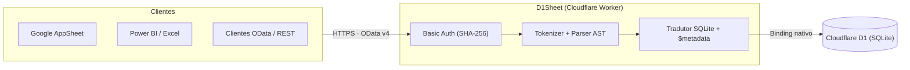

<p align="left">
  <a href="../README.md">← Voltar ao portfólio</a> ·
  <a href="../../README.md">Perfil</a>
</p>

<h1 align="center">🟠 D1Sheet</h1>

<p align="center">
  <strong>Gateway OData v4 serverless para Cloudflare D1</strong><br />
  Conectando SQLite na edge ao Google AppSheet, Power BI e Excel
</p>

<p align="center">
  
  
  
  
  
  
</p>

<p align="center">
  <a href="https://vieirafabiog.github.io/D1Sheet/"></a>
  <a href="https://github.com/vieirafabiog/D1Sheet"></a>
</p>

<p align="center">
  <a href="#origem">Por que criei</a> ·
  <a href="#como-funciona">Como funciona</a> ·
  <a href="#na-pratica">Na prática</a> ·
  <a href="#decisoes-tecnicas">Decisões técnicas</a> ·
  <a href="#proximos-passos">Próximos passos</a>
</p>

---

<a id="origem"></a>
## 💡 Por que criei

Quem já montou aplicativo no **Google AppSheet** conhece bem o dilema de onde guardar os dados quando o projeto deixa de ser um teste:

| Opção | O que funciona bem | Onde começa a travar |
| --- | --- | --- |
| **Google Sheets** | Muito rápido para começar e fácil de editar na mão. | Fica lento com poucos milhares de linhas, sem integridade relacional e sofre quando várias pessoas gravam ao mesmo tempo. |
| **SQL tradicional** (Postgres, MySQL, SQL Server) | Aguenta volume e consulta complexa com folga. | Pede servidor 24/7, custo fixo mesmo parado, IP estático e regra de firewall aberta. |
| **Cloudflare D1** | SQLite serverless na edge, resposta rápida e plano gratuito generoso (5M de leituras/dia). | Não tem porta TCP direta; só responde dentro do ecossistema Workers. O AppSheet não conecta nele sozinho. |

Como o AppSheet já tem suporte nativo ao protocolo **OData v4**, a ideia foi simples: colocar um Worker leve na frente do D1 para falar OData de um lado e SQLite do outro.

O efeito colateral bom de seguir o padrão OData v4 certinho é que o D1Sheet acabou não servindo só para AppSheet. Qualquer ferramenta compatível com OData — **Power BI**, **Excel (Power Query)**, **Tableau** ou integrações REST comuns — consegue consumir o banco direto, com delegação de filtros.

---

<a id="como-funciona"></a>
## 🧭 Como funciona

O Worker intercepta a requisição OData, valida a autenticação, descobre a estrutura da tabela direto no banco e compila os parâmetros de consulta em SQLite parametrizado.



<table>
  <tr>
    <td width="33%" valign="top"><strong>Zero configuração de schema</strong><br />Lê <code>sqlite_master</code> e <code>PRAGMA table_info</code> em tempo real para montar o documento de serviço e o XML <code>/$metadata</code> (EDMX). Criou tabela no D1, ela já aparece no cliente.</td>
    <td width="33%" valign="top"><strong>Parser OData próprio</strong><br />Em vez de montar SQL concatenando texto, o <code>$filter</code> passa por um tokenizer e um parser AST antes de virar cláusula <code>WHERE</code> parametrizada.</td>
    <td width="33%" valign="top"><strong>Leitura e escrita completas</strong><br />Suporta <code>GET</code>, <code>POST</code>, <code>PATCH</code>, <code>PUT</code> e <code>DELETE</code>. Na criação, usa <code>RETURNING *</code> do SQLite para devolver IDs gerados e valores padrão na mesma resposta.</td>
  </tr>
</table>

---

<a id="na-pratica"></a>
## ⚡ Na prática: de OData para SQLite

Um exemplo do que acontece por baixo dos panos quando o AppSheet ou o Power BI pede uma listagem filtrada, ordenada e paginada:

**1. Requisição recebida pelo Worker**
```http
GET /odata/Customers?$select=Id,Name,Balance&$filter=Balance ge 1000 and contains(Email,'@empresa.com')&$orderby=Balance desc&$top=20&$count=true
Authorization: Basic <credenciais>
```

**2. SQL gerado e executado no D1**
```sql
SELECT "Id", "Name", "Balance"
FROM "Customers"
WHERE ("Balance" >= ? AND INSTR("Email", ?) > 0)
ORDER BY "Balance" DESC
LIMIT ? OFFSET ?
-- params: [1000, '@empresa.com', 20, 0]
```

**3. Resposta devolvida ao cliente**
```json
{
  "@odata.context": "https://d1sheet.workers.dev/odata/$metadata#Customers",
  "@odata.count": 48,
  "@odata.nextLink": "https://d1sheet.workers.dev/odata/Customers?$select=Id,Name,Balance&$filter=...&$skip=20&$top=20",
  "value": [
    { "Id": 12, "Name": "Ana Souza", "Balance": 3450.0 }
  ]
}
```

> **Quer testar sem subir nada?** O [site oficial do D1Sheet](https://vieirafabiog.github.io/D1Sheet/) tem um simulador interativo onde dá para escrever queries OData e ver na hora o SQLite gerado.

<details>
  <summary><strong>Ver parâmetros OData e operações suportadas</strong></summary>

| Recurso | Exemplo | Tradução / Comportamento |
| --- | --- | --- |
| `$select` | `?$select=Id,Name` | Seleciona apenas as colunas pedidas |
| `$filter` (comparação e nulos) | `Balance ge 1000 and Email ne null` | `WHERE ("Balance" >= ? AND "Email" IS NOT NULL)` |
| `$filter` (funções de texto) | `contains`, `startswith`, `tolower` | Traduzidas para `INSTR(...)` e `LOWER(...)` |
| `$orderby` | `?$orderby=Balance desc, Name asc` | `ORDER BY "Balance" DESC, "Name" ASC` |
| `$top` e `$skip` | `?$top=25&$skip=50` | `LIMIT ? OFFSET ?` + `@odata.nextLink` automático |
| `$count` e `/$count` | `?$count=true` ou `/Customers/$count` | Retorna total compatível com os filtros |
| Chaves por parênteses ou barra | `Customers(1)`, `Customers(Id=1)`, `Customers/1` | Compatível com clientes OData e chamadas REST |
| Escrita (CRUD) | `POST`, `PATCH`, `PUT`, `DELETE` | `POST` retorna `201 Created` com `Location` e entidade via `RETURNING *` |

</details>

---

<a id="decisoes-tecnicas"></a>
## 🛠️ Decisões técnicas

Algumas escolhas que mantiveram o projeto enxuto e seguro para rodar na Cloudflare:

<table>
  <tr>
    <td width="50%" valign="top"><strong>Uma única dependência em produção</strong><br />O runtime usa apenas <strong>Hono</strong> para roteamento. Tokenizer, parser AST, tradutor SQL, gerador de <code>$metadata</code> e paginação foram escritos em TypeScript puro, deixando o bundle mínimo e sem cold start pesado.</td>
    <td width="50%" valign="top"><strong>Proteção contra SQL Injection</strong><br />Todo valor literal de filtro vai como parâmetro posicional (<code>?</code>) no D1. Nomes de tabelas e colunas passam por validação estrita de identificador (<code>/^[a-zA-Z_][a-zA-Z0-9_]*$/</code>) antes de entrar na query.</td>
  </tr>
  <tr>
    <td width="50%" valign="top"><strong>Basic Auth em tempo constante</strong><br />A comparação de credenciais faz hash <code>SHA-256</code> via Web Crypto API e compara os 32 bytes com <code>XOR</code> bit a bit, evitando vazamento por tamanho de senha ou timing attack — e rodando nativamente no runtime <code>workerd</code>.</td>
    <td width="50%" valign="top"><strong>Limites de paginação por padrão</strong><br />Páginas padrão de <code>100</code> registros e teto configurável de <code>1000</code> protegem a memória do Worker e evitam leituras exageradas acidentais no D1.</td>
  </tr>
</table>

<details>
  <summary><strong>Ver organização interna do código (<code>src/</code>)</strong></summary>

```text
src/
├── index.ts                  # Entrada do Worker e configuração do Hono
├── middleware/
│   └── auth.ts               # Middleware de HTTP Basic Auth
├── odata/
│   ├── tokenizer.ts          # Quebra expressões $filter em tokens
│   ├── parser.ts             # Monta a árvore sintática (AST)
│   ├── sqlTranslator.ts      # Compila AST e parâmetros OData em SQLite seguro
│   └── types.ts
├── routes/
│   └── odataRoutes.ts        # Endpoints /odata, /$metadata, /$count e CRUD
├── services/
│   ├── schemaService.ts      # Introspecção via sqlite_master/PRAGMA + tipos EDM
│   └── odataResponse.ts      # Formatação OData v4 e geração de @odata.nextLink
└── utils/
    ├── crypto.ts             # Comparação em tempo constante (Web Crypto)
    └── odataError.ts         # Padronização de erros HTTP/OData
```

O projeto conta ainda com suíte de testes automatizados cobrindo parsing, tradução SQL, metadados e operações CRUD localmente via Wrangler.

</details>

---

<a id="proximos-passos"></a>
## 🗺️ Status e próximos passos

O projeto está **em produção (v1.0)**, com licença MIT e deploy documentado para subir em poucos minutos na conta gratuita da Cloudflare.

- [x] Leitura OData v4 (`$filter`, `$select`, `$orderby`, `$top`, `$skip`, `$count`)
- [x] Geração dinâmica de `/$metadata` (EDMX) e paginação `@odata.nextLink`
- [x] Operações de escrita completas (`POST`, `PATCH`, `PUT`, `DELETE`) com `RETURNING *`
- [x] Site de documentação com simulador OData → SQLite em português e inglês
- [ ] Roteamento multi-tenant para atender múltiplos bancos D1 por header ou subpath

---

**Links:** [Repositório no GitHub](https://github.com/vieirafabiog/D1Sheet) · [Site oficial e simulador](https://vieirafabiog.github.io/D1Sheet/) · [Voltar ao portfólio](../README.md)
