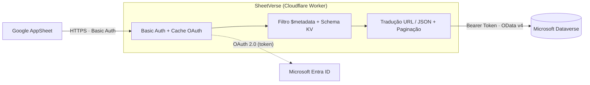

<p align="left">
  <a href="../README.md">← Voltar ao portfólio</a> ·
  <a href="../../README.md">Perfil</a>
</p>

<h1 align="center">🔗 SheetVerse</h1>

<p align="center">
  <strong>Proxy reverso OData v4 para Google AppSheet + Microsoft Dataverse</strong><br />
  Rodando em JavaScript puro na edge da Cloudflare Workers
</p>

<p align="center">
  
  
  
  
  
  
</p>

<p align="center">
  <a href="https://github.com/vieirafabiog/SheetVerse"></a>
</p>

<p align="center">
  <a href="#origem">Por que criei</a> ·
  <a href="#como-funciona">Como funciona</a> ·
  <a href="#na-pratica">Na prática</a> ·
  <a href="#decisoes-tecnicas">Decisões técnicas</a>
</p>

---

<a id="origem"></a>
## 💡 Por que criei

Tentar ligar o **Google AppSheet** direto no **Microsoft Dataverse** (Power Platform / Dynamics 365) pelo conector OData costuma travar em três pontos logo de cara:

| Gargalo na conexão direta | O que acontece sem o proxy | O que o SheetVerse resolve |
| --- | --- | --- |
| **Autenticação OAuth 2.0 (Entra ID)** | O Dataverse exige fluxo OAuth com credenciais de aplicação no Azure; configurar isso direto no AppSheet complica e expõe a complexidade no cliente. | O AppSheet fala **Basic Auth** simples com o Worker; o proxy negocia e renova o Bearer Token no Microsoft Entra ID por trás dos panos. |
| **Metadados gigantes (`$metadata`)** | O XML de metadados do Dataverse passa fácil de 30 MB com centenas de tabelas internas. O AppSheet congela, estoura timeout ou fica muito lento. | Intercepta o XML em tempo real, remove tabelas não autorizadas e colunas de sistema, e devolve só poucos KB com o que o app usa. |
| **Prefixos e incompatibilidades** | Nomes técnicos como `cr123_my_custom_tables`, GUIDs entre aspas que geram `400 Bad Request` e `PATCH`/`DELETE` rejeitados sem `If-Match`. | Virtualiza nomes de colunas via `schema.json` no KV, limpa GUIDs automaticamente e injeta os headers que o Dataverse exige. |

A ideia começou como um servidor Node.js com Express, mas foi migrada para **Cloudflare Workers** para rodar sem servidor ligado 24/7, com custo zero no plano gratuito (100 mil requisições/dia) e latência menor na comunicação com os servidores do AppSheet.

---

<a id="como-funciona"></a>
## 🧭 Como funciona

O SheetVerse fica no meio do caminho traduzindo autenticação, metadados, URLs, payloads JSON e links de paginação nos dois sentidos.



<table>
  <tr>
    <td width="33%" valign="top"><strong>Filtro de <code>$metadata</code> em tempo real</strong><br />Varre o XML do Dataverse, identifica quais <code>EntityTypes</code> pertencem aos <code>EntitySets</code> liberados no schema e corta todo o resto antes de devolver ao AppSheet.</td>
    <td width="33%" valign="top"><strong>Schema virtual no Cloudflare KV</strong><br />Um <code>schema.json</code> define quais tabelas ficam visíveis e qual <code>displayName</code> cada coluna assume. Se preferir expor tudo como está, o proxy entra sozinho em modo <strong>Pass-Through</strong>.</td>
    <td width="33%" valign="top"><strong>Tradução nos dois sentidos</strong><br />Converte nomes amigáveis para nomes técnicos do Dataverse em <code>$select</code>, <code>$filter</code>, <code>POST</code> e <code>PATCH</code>, e devolve o JSON já mapeado para o AppSheet — com <code>@odata.nextLink</code> reescrito para o proxy.</td>
  </tr>
</table>

---

<a id="na-pratica"></a>
## ⚡ Na prática: schema virtual e limpeza de requisições

No `schema.json` (armazenado no KV `SHEETVERSE_CONFIG`), você escolhe só o que o app precisa enxergar:

```json
[
  {
    "table": "cr123_my_custom_tables",
    "columns": [
      { "name": "cr123_mycustomtableid", "displayName": "id" },
      { "name": "cr123_price", "displayName": "price" },
      { "name": "cr123_date", "displayName": "date" }
    ]
  }
]
```

Quando o AppSheet faz uma chamada usando os nomes limpos — e enviando GUIDs com aspas, comportamento comum do conector OData dele — o Worker traduz tudo antes de bater no Dataverse:

**1. O que chega do AppSheet**
```http
GET /api/data/v9.2/cr123_my_custom_tables(id='a1b2c3d4-e5f6-7890-abcd-ef1234567890')?$select=id,price,date
Authorization: Basic <appsheet-user-pass>
```

**2. O que o SheetVerse encaminha ao Dataverse**
```http
GET https://<sua-org>.api.crm.dynamics.com/api/data/v9.2/cr123_my_custom_tables(a1b2c3d4-e5f6-7890-abcd-ef1234567890)?$select=cr123_mycustomtableid,cr123_price,cr123_date
Authorization: Bearer <token-entra-id-em-cache>
OData-Version: 4.0
Prefer: odata.maxpagesize=4000
```

Na volta, cada registro retornado pelo Dataverse tem as chaves remapeadas de `cr123_*` para `id`, `price` e `date`, e qualquer `@odata.nextLink` é reescrito para o endereço do Worker, garantindo que as páginas seguintes também passem pelo proxy autenticado.

<details>
  <summary><strong>Ver ajustes automáticos que o proxy faz entre AppSheet e Dataverse</strong></summary>

| Situação | O que quebra sem tratamento | O que o SheetVerse faz |
| --- | --- | --- |
| GUID com aspas no path ou filtro | AppSheet envia `(id='guid')` ou `'guid'` no `$filter` e o Dataverse responde `400 Bad Request`. | Remove nome de chave opcional e aspas simples ao redor de GUIDs válidos antes do encaminhamento. |
| Atualização e exclusão (`PATCH`/`DELETE`) | Dataverse exige controle de concorrência otimista e retorna `412 Precondition Failed`. | Injeta `If-Match: *` automaticamente quando o cliente não envia o header. |
| Paginação em tabelas grandes | `@odata.nextLink` aponta direto para `*.crm.dynamics.com`, onde o AppSheet não tem Bearer Token. | Aplica `Prefer: odata.maxpagesize` configurável e reescreve a origem de `@odata.nextLink` para o Worker. |
| Respostas `204` / `304` no Workers | O runtime da Cloudflare lança erro ao instanciar `Response` com body em status sem conteúdo. | Trata `204` e `304` explicitamente passando `null` no corpo da resposta. |
| Expiração de token OAuth | Tokens do Entra ID expiram a cada hora e derrubam sincronizações. | Mantém o token em cache no Isolate e renova em segundo plano quando faltam menos de 2 minutos. |

</details>

---

<a id="decisoes-tecnicas"></a>
## 🛠️ Decisões técnicas

Escolhas feitas pensando no limite de CPU e memória dos Cloudflare Workers (especialmente no plano gratuito):

<table>
  <tr>
    <td width="50%" valign="top"><strong>Lookups <code>O(1)</code> pré-compilados</strong><br />O <code>schema-manager.js</code> carrega o schema do KV uma vez por Isolate e monta mapas <code>Map</code>/<code>Set</code> (incluindo versões case-insensitive) e closures por tabela via <code>getProcessRowFn</code>, evitando varreduras repetidas em cada linha do JSON.</td>
    <td width="50%" valign="top"><strong>Pass-Through com custo mínimo</strong><br />Quando não há schema configurado no KV, o Worker evita até o <code>JSON.parse</code> na resposta de listagem — reescreve apenas o <code>@odata.nextLink</code> direto no texto e devolve o payload original.</td>
  </tr>
  <tr>
    <td width="50%" valign="top"><strong>Credenciais isoladas na Cloudflare</strong><br /><code>AZURE_TENANT_ID</code>, <code>AZURE_CLIENT_ID</code> e <code>AZURE_CLIENT_SECRET</code> ficam apenas nos Secrets do Worker e nunca aparecem no AppSheet nem no navegador do usuário.</td>
    <td width="50%" valign="top"><strong>Deploy automatizado ou manual</strong><br />Além do fluxo padrão com Wrangler CLI (<code>kv:key put</code>, <code>secret put</code> e <code>deploy</code>), o repositório traz um script <code>deploy.ps1</code> para subir segredos, schema e Worker de uma vez no Windows.</td>
  </tr>
</table>

<details>
  <summary><strong>Ver organização dos arquivos do projeto</strong></summary>

```text
├── worker.js            # Entrada do Cloudflare Worker, auth, cache OAuth e roteamento
├── metadata-filter.js   # Intercepta e enxuga o XML $metadata de 30 MB+ do Dataverse
├── schema-manager.js    # Mapeamento bidirecional O(1) entre nomes do Dataverse e displayName
├── schema.json          # Definição das tabelas e colunas expostas (enviada ao KV)
├── deploy.ps1           # Script PowerShell para subir secrets, schema no KV e Worker
├── wrangler.toml        # Configuração do Worker e binding do KV SHEETVERSE_CONFIG
└── .env.example         # Modelo das variáveis de ambiente e segredos
```

O endpoint `/health` também fica exposto sem depender do Dataverse para checagem rápida do Worker durante desenvolvimento local (`npx wrangler dev`) ou monitoramento.

</details>

---

**Links:** [Repositório no GitHub](https://github.com/vieirafabiog/SheetVerse) · [Voltar ao portfólio](../README.md)
