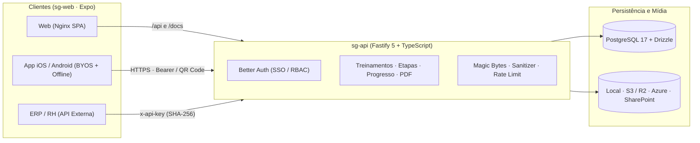

<p align="left">
  <a href="../README.md">← Voltar ao portfólio</a> ·
  <a href="../../README.md">Perfil</a>
</p>

<h1 align="center">🎓 Smart Guide</h1>

<p align="center">
  <strong>Plataforma self-hosted de treinamentos corporativos e documentação visual</strong><br />
  Guias passo a passo no navegador e no celular — com modo offline, exportação em PDF e storage plugável
</p>

<p align="center">
  
  
  
  
  
  
</p>

<p align="center">
  <a href="https://github.com/vieirafabiog/SmartGuide"></a>
</p>

<p align="center">
  <a href="#origem">Por que criei</a> ·
  <a href="#como-funciona">Como funciona</a> ·
  <a href="#fluxo">Fluxo de uso</a> ·
  <a href="#decisoes-tecnicas">Decisões técnicas</a>
</p>

---

<a id="origem"></a>
## 💡 Por que criei

Em quase toda empresa, o conhecimento operacional acaba espalhado em arquivos Word, PDFs soltos em pastas de rede ou mensagens no WhatsApp. Quando alguém novo entra — ou quando um processo muda — ninguém sabe qual versão é a certa, e boa parte da rotina acaba dependendo de uma única pessoa.

O **Smart Guide** nasceu para tirar esses procedimentos de arquivos perdidos e colocar tudo em uma plataforma própria da empresa, rodando no servidor dela (**self-hosted**), fácil de atualizar e acessível tanto no computador quanto no celular — inclusive quando o colaborador está em campo e sem sinal de internet.

<table>
  <tr>
    <td width="50%" valign="top"><strong>Antes</strong><br />Manuais espalhados em Word/PDF, difíceis de achar pelo celular, sem controle de versão e sem saber quem já estudou o conteúdo.</td>
    <td width="50%" valign="top"><strong>Com o Smart Guide</strong><br />Catálogo centralizado com guias passo a passo (texto, fotos e vídeos), progresso por etapa, download offline no app mobile e exportação em PDF pronto para imprimir.</td>
  </tr>
</table>

---

<a id="como-funciona"></a>
## 🧭 Como funciona

O projeto é um monorepo dividido entre a API (`sg-api`) e o cliente universal Web/Mobile (`sg-web`), pensado para subir em uma única máquina com `docker compose up -d --build`. No servidor, tudo roda em três containers: **PostgreSQL 17**, **Fastify** e **Nginx** (que serve o front-end estático e faz proxy de `/api/*`, `/docs` e `/health` na mesma porta).



<table>
  <tr>
    <td width="33%" valign="top"><strong>Conexão mobile por QR Code (BYOS)</strong><br />O app em Expo segue o modelo <em>Bring Your Own Server</em>: o admin exibe um QR Code no painel (<code>smartguide://connect?server=...</code>) e o colaborador conecta o celular direto no servidor da empresa sem digitar URL.</td>
    <td width="33%" valign="top"><strong>Estudo offline e PDF</strong><br />No celular, o usuário baixa etapas, imagens e vídeos localmente (via <code>expo-sqlite</code> e <code>expo-file-system</code>) para estudar sem internet. Qualquer treinamento também exporta um manual em PDF com capa, índice e fotos.</td>
    <td width="33%" valign="top"><strong>Storage plugável</strong><br />Trocar onde fotos e vídeos ficam salvos é questão de <code>.env</code>: funciona com disco local, qualquer bucket <strong>S3</strong> (AWS, MinIO, R2), <strong>Azure Blob Storage</strong> ou biblioteca do <strong>SharePoint</strong> via Graph API.</td>
  </tr>
</table>

---

<a id="fluxo"></a>
## 👥 Perfis e fluxo de uso

O acesso é controlado em duas camadas: papéis globais na instância e permissões específicas por treinamento (útil quando um guia precisa ficar restrito a um setor).

| Perfil | O que faz na plataforma |
| --- | --- |
| **Administrador (`admin`)** | Gerencia usuários, categorias, identidade da instância (nome, logo, QR Code de pareamento) e chaves da API externa para integração com RH/ERP. |
| **Criador (`creator`)** | Monta treinamentos com capa, editor rico e etapas ordenáveis com imagens e vídeos; controla status (`Rascunho`, `Publicado`, `Arquivado`) e compartilha acesso por pessoa (`owner`, `editor` ou `viewer`). |
| **Colaborador (`user`)** | Busca treinamentos no catálogo, estuda etapa por etapa marcando conclusão, baixa para uso offline no celular e exporta em PDF quando precisa arquivar ou imprimir. |

A interface inteira e os guias de uso já nascem com suporte a três idiomas: **Português (`pt-BR`)**, **English (`en`)** e **Español (`es`)**.

<!--
ESPAÇO PARA PRINTS
Quando quiser adicionar telas do Smart Guide, salve os arquivos nesta pasta (ex.: ./prints/catalogo.png) e descomente o bloco abaixo:

---

## 🖼️ Telas

| Catálogo e estudo | Editor de etapas | App Mobile (offline) |
| :---: | :---: | :---: |
|  |  |  |
-->

---

<a id="decisoes-tecnicas"></a>
## 🛠️ Decisões técnicas

Pontos que fizeram diferença na segurança e na facilidade de hospedar a ferramenta dentro da infraestrutura de uma empresa:

<table>
  <tr>
    <td width="50%" valign="top"><strong>Autenticação flexível e segura</strong><br />Usa <strong>Better Auth</strong> com suporte a e-mail/senha, <strong>Google SSO</strong> e <strong>Microsoft Entra ID</strong>, além de cadastro público desabilitado por padrão para uso corporativo. Sessões e papéis são sempre validados no servidor.</td>
    <td width="50%" valign="top"><strong>Upload e conteúdo blindados</strong><br />Arquivos enviados passam por inspeção de <em>magic bytes</em> (<code>file-type</code>) — bloqueando <code>.svg</code>, HTML e executáveis mesmo se renomeados. Textos formatados passam por <code>sanitize-html</code> com allowlist estrita antes de salvar, renderizar e gerar PDF.</td>
  </tr>
  <tr>
    <td width="50%" valign="top"><strong>Mídia privada com streaming real</strong><br />Por padrão (<code>STORAGE_PUBLIC_MEDIA=false</code>), fotos e vídeos ficam protegidos atrás de sessão autenticada e URLs assinadas de curta duração, com suporte a HTTP <code>Range</code> (<code>206 Partial Content</code>) para avançar vídeos sem travar.</td>
    <td width="50%" valign="top"><strong>Pronto para integrar com ERP/RH</strong><br />A API externa (<code>/api/v1/ext/*</code>) trabalha com chaves de escopo limitado (<code>users:read</code>, <code>users:write</code>, <code>trainings:read</code>), exibidas só uma vez (<code>sg_live_...</code>), salvas apenas como hash <code>SHA-256</code> e comparadas com <code>crypto.timingSafeEqual</code>.</td>
  </tr>
</table>

<details>
  <summary><strong>Ver estrutura do monorepo e operação em produção</strong></summary>

```text
SmartGuide/
├── sg-api/                    # API REST em Node.js 22 + Fastify 5 + Drizzle ORM
│   ├── drizzle/               # Migrações SQL (inclui busca com pg_trgm)
│   ├── src/
│   │   ├── auth/              # Better Auth, guards RBAC e OAuth mobile
│   │   ├── modules/           # trainings, steps, attachments, media, progress, permissions, users, api-keys, integrations
│   │   ├── security/          # api-key (SHA-256), file-validator (magic bytes) e html-sanitizer
│   │   └── storage/           # Conectores: local, s3, azure e sharepoint
│   └── test/                  # Suíte automatizada em Vitest (25 arquivos de teste)
├── sg-web/                    # Cliente universal (Web + iOS + Android) em Expo SDK 57 + Expo Router
├── docker/
│   ├── nginx/                 # Proxy reverso e entrega do bundle web em porta única
│   └── scripts/               # backup-postgres.sh e restore-postgres.sh
├── docs/                      # Guias de uso e documentação técnica em pt-BR, en e es
└── docker-compose.yml         # Stack completa (postgres + sg-api + sg-web + perfil opcional s3/MinIO)
```

- Na inicialização, o `sg-api` aplica migrações do Drizzle usando `pg_advisory_lock` (evitando condição de corrida entre réplicas) e faz o seed inicial do admin de forma idempotente.
- A documentação interativa da API fica disponível localmente em `/docs` (Swagger UI sem depender de CDN externo).
- Inclui scripts prontos de backup compactado e restore do PostgreSQL (`docker/scripts/`).

</details>

---

**Links:** [Repositório no GitHub](https://github.com/vieirafabiog/SmartGuide) · [Voltar ao portfólio](../README.md)
