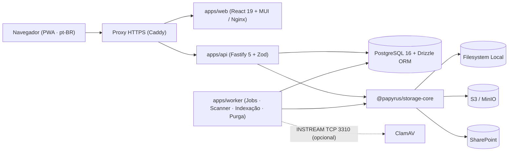

<p align="left">
  <a href="../README.md">← Voltar ao portfólio</a> ·
  <a href="../../README.md">Perfil</a>
</p>

<h1 align="center">📃 papyrus</h1>

<p align="center">
  <strong>Gerenciador Eletrônico de Documentos (GED) self-hosted</strong><br />
  Metadados tipados, versões imutáveis, múltiplos storages e busca no conteúdo dos arquivos
</p>

<p align="center">
  
  
  
  
  
  
</p>

<p align="center">
  <a href="https://github.com/vieirafabiog/papyrus"></a>
</p>

<p align="center">
  <a href="#origem">Por que criei</a> ·
  <a href="#como-funciona">Como funciona</a> ·
  <a href="#decisoes-tecnicas">Decisões técnicas</a>
</p>

---

<a id="origem"></a>
## 💡 Por que criei

Quando documentos corporativos ficam espalhados entre pastas de rede, drives diferentes e anexos de e-mail, encontrar o que se precisa vira trabalho manual: abre arquivo por arquivo, confere se aquela é mesmo a última versão e torce para ninguém ter perdido um vencimento importante.

O **papyrus** foi construído para centralizar esse acervo dentro da infraestrutura da própria empresa (**self-hosted**), sem depender de um único local de armazenamento e tratando governança desde a base — com versões que não se sobrescrevem, metadados validados no servidor, fluxo de aprovação humana e trilha de auditoria.

<table>
  <tr>
    <td width="50%" valign="top"><strong>Antes</strong><br />Arquivos espalhados em vários storages, busca limitada ao nome do arquivo, sobrescrita acidental de versões e nenhum aviso antes de contratos ou certidões vencerem.</td>
    <td width="50%" valign="top"><strong>Com o papyrus</strong><br />Acervo organizado em pastas, tags e categorias com metadados tipados, busca no conteúdo e nos filtros combinados, histórico imutável de versões, aprovações sequenciais e alertas de vencimento.</td>
  </tr>
</table>

---

<a id="como-funciona"></a>
## 🧭 Como funciona

O sistema roda como um **monólito modular** em `pnpm workspaces`, empacotado com Docker Compose atrás de um proxy HTTPS **Caddy**. A API (`apps/api`) cuida das requisições, autorização e metadados; o worker assíncrono (`apps/worker`) processa quarentena/antivírus, indexação de texto, vencimentos, checagem de integridade e expurgo físico; e a camada `@papyrus/storage-core` abstrai onde os binários ficam salvos.



<table>
  <tr>
    <td width="33%" valign="top"><strong>Metadados tipados e busca textual</strong><br />Cada categoria define seus campos (<code>TEXT</code>, <code>NUMBER</code>, <code>DATE</code>, <code>BOOLEAN</code>, <code>SINGLE_SELECT</code>, <code>MULTI_SELECT</code>). A pesquisa combina filtros no PostgreSQL com extração e indexação assíncrona do texto dos documentos, respeitando as permissões do usuário antes mesmo da contagem.</td>
    <td width="33%" valign="top"><strong>Versões imutáveis e aprovação</strong><br />Upload de revisão nunca apaga o histórico (<em>append-only</em> com checksum <code>SHA-256</code>), e restaurar cria uma nova versão vigente. Fluxos de aprovação vinculam cada decisão exatamente ao <code>document_version_id</code>, junto a controle de vencimentos com janelas de <code>7</code> a <code>90</code> dias.</td>
    <td width="33%" valign="top"><strong>Múltiplos storages desacoplados</strong><br />Mesmo contrato para <strong>Filesystem Local</strong> (escrita atômica), <strong>S3 / MinIO</strong> (com URLs pré-assinadas curtas e proteção anti-SSRF) e <strong>SharePoint</strong>, com roteamento por categoria documental e pré-visualização inline de PDFs, imagens, TIFF e arquivos Office.</td>
  </tr>
</table>

---

<a id="decisoes-tecnicas"></a>
## 🛠️ Decisões técnicas

Pontos de arquitetura voltados para uso corporativo real, onde vazamento de documento ou perda de histórico não são aceitáveis:

<table>
  <tr>
    <td width="50%" valign="top"><strong>Autorização granular (<code>DENY &gt; ALLOW</code>)</strong><br />Toda operação passa por checagem <code>action + resource + scope</code> (<code>GLOBAL</code>, <code>CATEGORY</code>, <code>FOLDER</code>, <code>DOCUMENT</code>) no servidor, com negação por padrão, herança de pasta e precedência explícita de bloqueio (<code>DENY</code>).</td>
    <td width="50%" valign="top"><strong>Upload em streaming com quarentena</strong><br />Arquivos recebem chaves opacas sem nome original nem PII (<code>org/.../versions/.../objectId</code>), passam por conferência de MIME por <em>magic bytes</em>, checksum <code>SHA-256</code> em stream e verificação opcional no <strong>ClamAV (<code>INSTREAM</code>)</strong> em modo <em>fail-closed</em>.</td>
  </tr>
  <tr>
    <td width="50%" valign="top"><strong>Cofre de segredos e auditoria imutável</strong><br />Senhas com <strong>Argon2id</strong>, sessões <code>HttpOnly</code> com rotação e CSRF <em>double-submit</em> em tempo constante. Credenciais de storage e SMTP são cifradas com <strong>AES-256-GCM</strong> (chave mestra externa) e a tabela <code>audit_events</code> é <em>append-only</em>, sem registrar tokens ou binários.</td>
    <td width="50%" valign="top"><strong>Retenção, <em>legal hold</em> e operação previsível</strong><br />Políticas de retenção por categoria com trava de <em>legal hold</em>, lixeira com janela de restauração, expurgo físico idempotente (<code>DELETE_PENDING</code>), containers não-root, migrations com advisory lock e scripts dedicados de backup e restore coordenado.</td>
  </tr>
</table>

<details>
  <summary><strong>Ver estrutura do monorepo e suítes de verificação</strong></summary>

```text
papyrus/
├── apps/
│   ├── web/                       # SPA/PWA em React 19 + Vite 7 + MUI 7 + TanStack Query (Nginx não-root)
│   ├── api/                       # Servidor Fastify 5 + Zod (auth, documentos, busca, workflows, preview, links, relatórios)
│   └── worker/                    # Jobs assíncronos (upload/scanner, indexação de texto, vencimentos, integridade e purga)
├── packages/
│   ├── domain/                    # Entidades, máquinas de estado, regras de negócio e portas (sem SDK/framework)
│   ├── contracts/                 # Schemas Zod compartilhados e contratos HTTP
│   ├── auth/                      # Argon2id, sessões server-side, papéis e motor de autorização
│   ├── database/                  # Schema Drizzle ORM, migrations SQL e repositórios com filtro de escopo autorizado
│   ├── storage-core/              # Contrato StorageProvider, registry e cofre AES-256-GCM
│   ├── storage-local/             # Storage em filesystem local (escrita atômica, anti path-traversal e sem symlinks)
│   ├── storage-s3/                # Storage S3 / MinIO (AWS SDK v3 isolado, anti-SSRF e URLs assinadas curtas)
│   ├── storage-sharepoint/        # Conector de armazenamento para SharePoint
│   ├── file-processing/           # Magic bytes, SHA-256 em stream, extração de texto e adaptador ClamAV
│   ├── notifications/             # Notificações internas e entrega SMTP
│   ├── config/                    # Validação tipada de ambiente e políticas de upload
│   └── ui/                        # Tema próprio e componentes reutilizáveis
├── infra/                         # Docker Compose v2 (imagens fixadas), perfil lab (MinIO/ClamAV) e Caddyfile
└── scripts/                       # Backup/restore coordenado e auditoria automática de dependências/licenças
```

- **Qualidade automatizada:** Biome (lint/format), TypeScript `strict` (`noUncheckedIndexedAccess` + `exactOptionalPropertyTypes`), Vitest (unitários, contrato e segurança), integração com **Testcontainers** (PostgreSQL 16 e MinIO reais), testes de operação (ciclo completo de backup/restore), **Playwright** E2E e benchmark reproduzível de carga.
- **Sem telemetria externa:** nenhum nome de arquivo, metadado ou log sai do servidor da organização.

</details>

---

**Links:** [Repositório no GitHub](https://github.com/vieirafabiog/papyrus) · [Voltar ao portfólio](../README.md)
